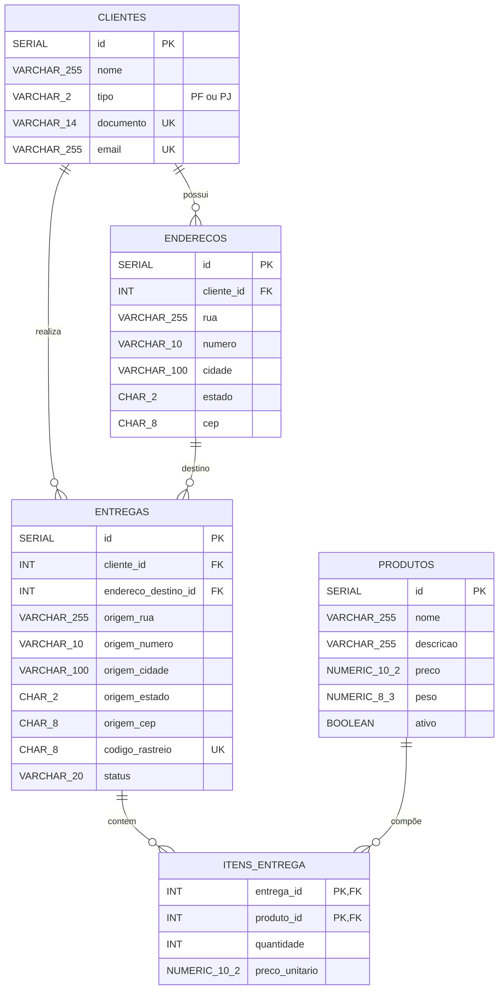

# VelozBR Transportadora

Projeto de Onboarding feito em Java desenvolvido para praticar programação orientada a objetos, modelagem de banco de dados e desenvolvimento back-end, com foco em gerenciamento de entregas.

A aplicação tem **duas interfaces** sobre o mesmo núcleo (models, validation, db e utils):

- **Terminal:** menu interativo via `Scanner` (`app.Main`).
- **Web:** painel com Servlets + JSP rodando em Tomcat 9 via Gretty.

Os dados são persistidos em **PostgreSQL** através de JDBC puro, com camada DAO.

## Funcionalidades

- Cadastro e edição de clientes **PF** (CPF) e **PJ** (CNPJ), com validação de documento (dígitos verificadores), e-mail, nome/razão social.
- Cadastro de múltiplos endereços por cliente (rua, número, cidade, estado e CEP), com edição.
- Registro, edição e exclusão de produtos com nome, descrição, preço e peso.
- Criação e edição de entregas vinculando um cliente, um endereço de destino e um ou mais produtos (com quantidade e preço unitário).
- Geração automática de código de rastreio (formato com país + UF + números, sem repetição por estado).
- Exibição da entrega com rastreio, origem, destino, itens e total.
- Atualização do status (Pendente, Em transito, Entregue ou Cancelada) com validação da transição.
- Painel operacional com indicadores (entregas em andamento/concluídas, total de clientes e produtos) e as 5 entregas mais recentes.
- Mensagens de erro e sucesso nas telas (`alerta.jspf`) e validação de dados de entrada em cada etapa.
- Unicidade de CPF/CNPJ, e-mail e nome de produto verificada antes de salvar.

## Tecnologias

- Java 17+ (usa `Map.ofEntries`, `Normalizer`, etc.)
- Gradle (wrapper incluso) com plugins `war`, `application` e `org.gretty`
- Servlet API 4.0.1 / JSP 2.3.3 (Tomcat 9 via Gretty)
- PostgreSQL + driver JDBC `org.postgresql:postgresql:42.7.12`
- HTML/CSS (`style.css`) e JSP com partials (`sidebar.jspf`, `alerta.jspf`)

## Estrutura do projeto

```text
src/main/
├── java/
│   ├── app/
│   │   └── Main.java                    # Ponto de entrada do modo terminal e menu principal
│   ├── controllers/                     # Fluxo do modo terminal
│   │   ├── ClienteController.java       # Cadastro de clientes
│   │   ├── ProdutoController.java       # Cadastro de produtos
│   │   └── EntregaController.java       # Nova entrega e atualização de status
│   ├── servlets/                        # Camada web (HTTP)
│   │   ├── ClientesServlet.java         # /clientes
│   │   ├── EnderecoServlet.java         # /enderecos
│   │   ├── ProdutoServlet.java          # /produtos
│   │   ├── EntregaServlet.java          # /lancar-entrega e /entregas/editar
│   │   ├── ListarEntregasServlet.java   # /lista-entregas
│   │   ├── AtualizarStatusServlet.java  # /atualizar-status
│   │   └── PingServlet.java             # /ping (verificação rápida)
│   ├── db/
│   │   ├── ConnectionService.java       # Conexão JDBC (senha via DB_PASSWORD)
│   │   ├── ClienteDao.java
│   │   ├── EnderecoDao.java
│   │   ├── ProdutoDao.java
│   │   ├── EntregaDao.java
│   │   └── schema.sql                   # Tabelas do banco de dados
│   ├── models/
│   │   ├── Cliente.java                 # Modelo do cliente
│   │   ├── TipoCliente.java             # Enum PF / PJ
│   │   ├── Endereco.java                # Modelo do endereço
│   │   ├── Produto.java                 # Modelo do produto
│   │   ├── Entrega.java                 # Modelo da entrega e cálculo do total
│   │   └── ItemEntrega.java             # Item (produto, quantidade, preço unitário)
│   ├── service/
│   │   └── Sistema.java                 # Orquestra os controllers do modo terminal
│   ├── utils/
│   │   ├── CodRastreioGen.java          # Geração de códigos de rastreio
│   │   ├── CpfUtil.java                 # Validação de CPF
│   │   └── CnpjUtil.java                # Validação de CNPJ
│   └── validation/
│       ├── Valid.java                   # Interface genérica de validação
│       ├── ClienteValid.java
│       ├── EnderecoValid.java
│       ├── ProdutoValid.java
│       └── EntregaValid.java
└── webapp/
    ├── index.jsp                        # Painel operacional
    ├── lista-clientes.jsp / form-cliente.jsp
    ├── form-endereco.jsp
    ├── lista-produtos.jsp / form-produto.jsp
    ├── lista-entregas.jsp / form-entrega.jsp
    ├── assets/css/style.css
    └── WEB-INF/
        ├── web.xml
        └── partials/                    # sidebar.jspf e alerta.jspf
```

## Diagrama do banco de dados



## Pré-requisitos

- JDK 17 ou superior
- PostgreSQL em execução em `localhost`

## Configuração

1. Crie o banco e o usuário no PostgreSQL. Por padrão, `ConnectionService` usa:

   ```text
   URL:     jdbc:postgresql://localhost:5432/nome_do_seu_banco
   Usuário: seu_user
   ```
   Ajuste esses valores em `src/main/java/db/ConnectionService.java`.

2. Defina a senha do banco na variável de ambiente `DB_PASSWORD`. Ela **não** fica no código; se não estiver definida, a conexão lança erro.

   ```bash
   export DB_PASSWORD=sua_senha
   ```

   O arquivo `.env` fica no `.gitignore` e **não deve ser versionado**.

## Como executar

### Versão web (Servlets + JSP)

```bash
./gradlew appRun
```

Acesse `http://localhost:8080/`. Para checar se o servidor subiu, abra `http://localhost:8080/ping`.

### Versão terminal

```bash
./gradlew run
```

O `build.gradle` já repassa a entrada padrão (`standardInput = System.in`) para o menu funcionar.

## Rotas da versão web

| Rota                | Descrição                                             |
|---------------------|-------------------------------------------------------|
| `/`                 | Painel operacional (`index.jsp`)                      |
| `/clientes`         | Listagem, cadastro e edição de clientes               |
| `/enderecos`        | Cadastro e edição de endereços do cliente             |
| `/produtos`         | Listagem, cadastro, edição e exclusão de produtos     |
| `/lancar-entrega`   | Criação de nova entrega                               |
| `/entregas/editar`  | Edição de entrega existente                           |
| `/lista-entregas`   | Listagem de entregas                                  |
| `/atualizar-status` | Atualização de status da entrega (POST)               |
| `/ping`             | Verificação rápida de que a aplicação está no ar      |

## Como usar (modo terminal - desatualizado)

Ao iniciar o programa, o menu principal oferece as opções:

```text
1- Cadastrar Cliente.
2- Registrar Produto.
3- Nova Entrega.
4- Atualizar Status.
5- Sair.
```

Fluxo típico:

1. Cadastre pelo menos um cliente (com endereço).
2. Cadastre pelo menos um produto.
3. Selecione o cliente e o produto para registrar a entrega.
4. O sistema mostra o resumo da entrega com o total calculado.
5. Para mudar o status de uma entrega (Pendente, Em transito, Entregue ou Cancelada), escolha `4`.
6. O menu volta para nova operação ou encerra ao escolher `5`.

## Observações importantes

- O projeto é uma prática de orientação a objetos e back-end Java, não uma aplicação de produção.
- Não há autenticação nem controle de acesso nas telas web.
- As credenciais de conexão (URL e usuário) estão fixas em `ConnectionService`; apenas a senha vem de variável de ambiente.

## Conceitos praticados

- Classes, atributos e métodos; encapsulamento com getters e setters.
- Enum com atributos (`TipoCliente`).
- Associação entre objetos (`Cliente`, `Endereco`, `Produto`, `Entrega`, `ItemEntrega`).
- Coleções com `ArrayList`, `List`, `Map` e `Set`.
- Interface genérica de validação (`Valid<T>`) e validações em classes separadas.
- Separação em camadas: controllers/servlets, validation, DAO e models.
- JDBC com PostgreSQL e padrão DAO.
- Servlets (`doGet`/`doPost`), JSP, partials e redirecionamento com mensagens.
- Modelagem relacional: chaves estrangeiras, `UNIQUE`, `CHECK` e chave composta.
- Build com Gradle e configuração via variável de ambiente.